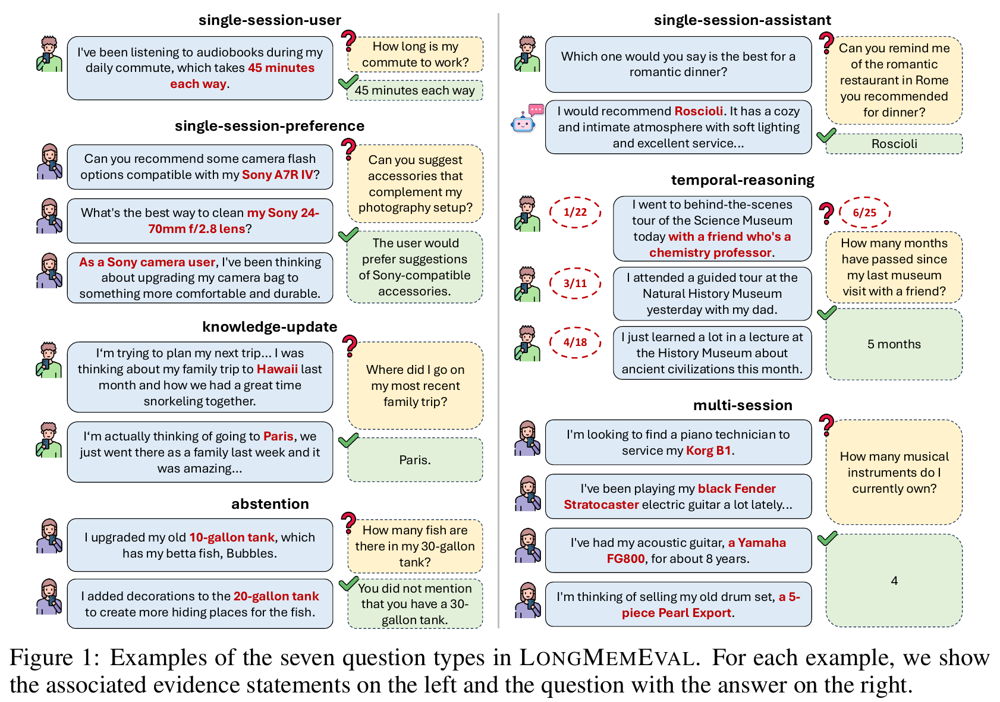
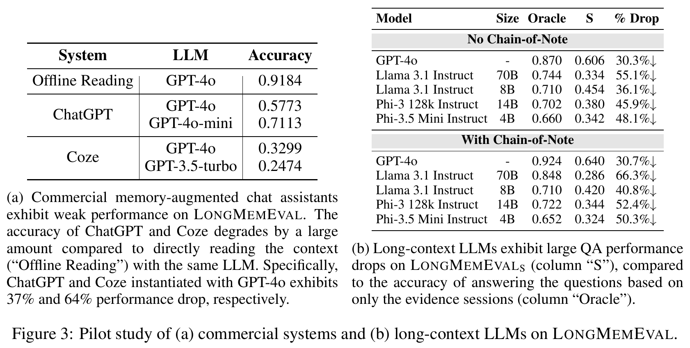
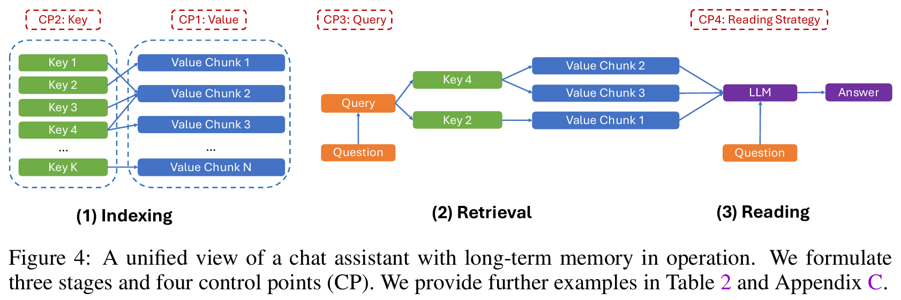
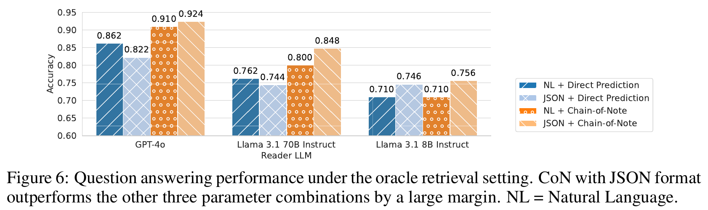
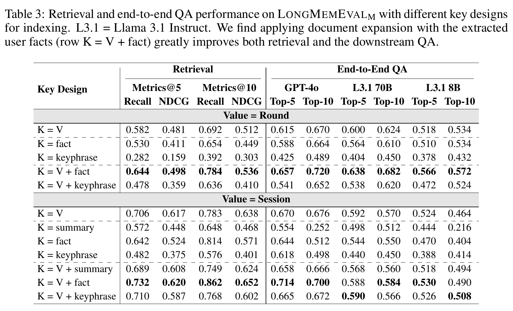

# LongMemEval：长期记忆不是“搜到一条旧事实”那么简单

> 原文：[[LongMemEval - Benchmarking Chat Assistants on Long-Term Interactive Memory.pdf]]  
> 会议：ICLR 2025  
> 官方页面：https://proceedings.iclr.cc/paper_files/paper/2025/hash/d813d324dbf0598bbdc9c8e79740ed01-Abstract-Conference.html  
> 数据与代码：https://github.com/xiaowu0162/LongMemEval

## 关键图表阅读路线

原图来自本目录的 28 页 ICLR 2025 版 PDF，以下页码均按 PDF 从第 1 页起计数。按“测什么 → 为什么难 → 怎样改进系统”的顺序阅读。

| 阅读位置 | 原图表 / PDF 页码 | 重点问题 |
|---|---|---|
| 第 4 节 | Figure 1 / 第 3 页 | 长期记忆为何不只是找回一个事实？ |
| 第 7 节 | Figure 3 / 第 6 页 | 外部记忆和长窗口分别暴露哪些问题？ |
| 第 8 节 | Figure 4 / 第 7 页 | 存储、检索、阅读的四个控制点在哪里？ |
| 第 8 节 CP4 | Figure 6 / 第 10 页 | 已找到全部证据，为什么仍可能回答错？ |
| 第 9 节 | Table 3 / 第 9 页 | 扩展检索 Key 与仅压缩内容有什么区别？ |

## 0. 为什么把它作为第 8 篇

第 5 篇 MemoryBank 提出了长期存储、检索、画像和遗忘，但只有 10 天、194 个 probing questions，缺少跨大量会话推理、信息更新、时间约束和拒答。LongMemEval 正好把“好像记得用户”拆成可测量能力，并把系统设计分为 indexing、retrieval、reading 三阶段。它是五篇中的最高难度，也是从“读架构”进入“能设计严谨 baseline”的转折点。

预期掌握：基准构造、在线记忆评测、五类能力、七类题、value/key/query/reader 四个控制点、Recall/NDCG/QA 三层指标及长上下文的失效原因。

## 1. 三层摘要

### 一句话

LongMemEval 用 500 个专家整理的问题和可扩展到 115k/1.5M token 的多会话历史，系统评测信息提取、跨会话推理、知识更新、时间推理和未知拒答，并证明记忆设计必须同时优化索引、检索与阅读。

### 三句话

1. 现有 benchmark 常用短的 human-human 对话，忽略助手说过的内容、用户状态更新和复杂时间参照。
2. LongMemEval 把证据会话埋入大量无关但不冲突的 task-oriented 会话中，要求系统逐 session 在线处理，最后回答问题。
3. 将 session 拆为 round、用抽取的 user facts 扩展 key、做 time-aware query expansion，并以 JSON + Chain-of-Note 阅读，可显著提升召回和最终问答；但压缩过度会丢信息，弱模型也会因检索上下文过长而下降。

### 一段话

每个样本是 $(\mathcal S,q,t_q,a)$：带时间戳的历史会话序列、最终问题、提问时间和答案。500 个问题覆盖 164 个用户属性，证据最多跨 6 个 session；历史可编译为 LongMemEval-S（约 115k token/题）或 M（500 sessions、约 1.5M token）。评测既看最终 QA，也看带人工证据位置的 Recall@k/NDCG@k。论文统一分析 value 的粒度、key 的表示、query 的时间扩展和 reader 的阅读策略，揭示“召回—读懂—正确作答”是三个不同瓶颈。

## 2. 问题、动机与缺口

### Task

聊天助手持续接收按时间到来的 sessions，不能预知未来问题。所有互动结束后，用户提出问题，系统须从自己的长期记忆中检索、整合并回答，必要时承认未知。

### 一个例子

用户 5 月说每周工作 40 小时，旺季多 10 小时；6 月又说已经换成每周 35 小时。问题可能问：

- “旺季时我当时每周多少小时？”——需要算 40+10。
- “我现在通常每周多少小时？”——需要知识更新，不能拿最相似的旧事实。
- “上个月我工作多少？”——要结合提问时间和 session 时间。
- “我的办公室在哪？”——若从未提过，应拒答。

### Gap

MemoryBank 等较短，LoCoMo 等未全面覆盖助手侧信息、更新与拒答；长上下文 benchmark 又通常把一切一次塞入 prompt，不测在线记忆组件。本文主张：**长期交互记忆必须评价记录、召回、更新、时间推理和不乱答，且历史长度应可扩展。**

## 3. 形式化

论文定义样本四元组：

$$
(\mathcal S,q,t_q,a)
$$

其中：

$$
\mathcal S=[(t_1,S_1),(t_2,S_2),\ldots,(t_N,S_N)],\quad t_1<\cdots<t_N<t_q
$$

- $S_i$：第 $i$ 个多轮 user-assistant session；
- $t_i$：该 session 的时间戳；
- $N$：历史 session 数；
- $q$：最终用户问题；$t_q$：提问日期；
- $a$：短答案，开放题时是自然语言评分 rubric。

每个 $S_i$ 可拆成 rounds，一轮是用户消息加助手回复。测试时 $S_i$ 按顺序逐个提供，符合在线系统“当时还不知道未来会问什么”的条件。若先看到问题再构造记忆，属于信息泄漏。

## 4. 五项能力与七类题



*来源：原论文 Figure 1，PDF 第 3 页。*

**读图：** 每组左侧给历史证据，右侧给测试问题和目标答案；红字突出关键信息。题型既区分用户说过的话、助手说过的话，也覆盖偏好、多会话整合、时间、知识更新和拒答。

**具体看两个例子：** Knowledge-update 中较早的家庭旅行地点是 Hawaii，后来更新为 Paris，回答“最近一次”必须识别更新。Abstention 中历史只有 10 与 20 加仑鱼缸，追问 30 加仑时不能凭相似记录编造数量。

**边界：** 图解释每类能力的任务定义，不是模型已答对这些题的结果。示例右侧的答案是评测目标，实际系统输入不能获得它；评测也必须区分找不到证据与证据根本不存在。

### 五项能力

1. **Information Extraction (IE)**：从长历史找用户或助手提过的具体信息。
2. **Multi-Session Reasoning (MR)**：跨多个 session 聚合、比较、计算。
3. **Knowledge Update (KU)**：识别用户状态变化，以新事实覆盖或版本化旧事实。
4. **Temporal Reasoning (TR)**：结合时间戳和“上个月/三周后”等表达。
5. **Abstention (ABS)**：信息不存在时回答不知道。

### 七类问题

single-session-user、single-session-assistant、single-session-preference、multi-session、knowledge-update、temporal-reasoning、abstention。ABS 从其他类型抽 30 题改成 false premise。注意 single-session-preference 是开放式个性化，不只是事实抽取。

## 5. 数据构造

### 5.1 问题与证据

定义 5 类、164 个用户属性本体：lifestyle、belongings、life events、situational context、demographic information。LLM 提议 seed 问答，专家筛选改写；每类最初约 1,000 个候选，最终保留率约 5%。答案被人工拆成带可选时间戳的 evidence statements。

### 5.2 Evidence sessions

用 user LLM 与 assistant LLM 把证据自然嵌入 task-oriented 对话，例如不直接说“买了车”，而是在询问保险时顺带透露。全部 evidence sessions 人工检查；约 70% 被人工编辑。多数问题跨 session，最多需要 6 个证据会话。

### 5.3 History compilation

证据会话与无关会话混排，无关内容来自非冲突模拟会话、ShareGPT 和 UltraChat，并赋合理时间戳。

| 设置 | 历史规模 | 用途 |
|---|---|---|
| LongMemEval-S | 约 50 sessions，115k tokens/题 | 长上下文模型可勉强一次读入 |
| LongMemEval-M | 500 sessions，约 1.5M tokens | 必须依赖外部记忆/RAG |

这种“可控 haystack”利于定位证据，但无关会话被设计为不冲突，可能低估真实生活中近似、矛盾和重复事实的难度。

## 6. 评测指标

### 6.1 End-to-end QA

用 `gpt-4o-2024-08-06` 按题型 rubric 判断回答。元评测中与人类专家一致率超过 97%。这仍是 LLM-as-a-Judge：应保留人工抽检、版本固定和判决理由，特别是开放式 preference 题。

### 6.2 Recall@k

$$
\operatorname{Recall@k}=\frac{|G\cap R_k|}{|G|}
$$

$G$ 是所有金标证据条目，$R_k$ 是 top-$k$ 检索结果。若两条证据只找回一条，Recall=0.5。它不惩罚前 $k$ 中其余噪声，也不反映 reader 是否会正确使用。

### 6.3 NDCG@k

二元相关时可理解为：

$$
\operatorname{DCG@k}=\sum_{j=1}^{k}\frac{rel_j}{\log_2(j+1)},\qquad
\operatorname{NDCG@k}=\frac{\operatorname{DCG@k}}{\operatorname{IDCG@k}}
$$

$rel_j\in\{0,1\}$ 表示第 $j$ 位是否是证据；IDCG 是理想排序。NDCG 同时奖励找全和排前，但仍不能评价生成答案是否忠实。

## 7. Pilot：商业记忆与长上下文都不够



*来源：原论文 Figure 3，PDF 第 6 页；商业系统实验在 2024 年 8 月前两周进行。*

**分开读两个面板：** (a) 用简化历史比较商业产品在线记忆与离线直接阅读；(b) 用 LongMemEval-S 比较只给证据的 Oracle 与完整历史 S。两侧任务条件和样本设置不同，不能当成同一排行榜。

**具体比较：** (a) 中 GPT-4o 离线阅读为 0.9184，ChatGPT 对应设置为 0.5773；(b) 中不使用 CoN 的 GPT-4o 从 Oracle 0.870 到完整历史 0.606。后一项下降 0.264，即 26.4 个百分点；表中的 30.3% 则是相对下降，两个口径不同。

**边界：** 这些是论文当时版本和工作流下的历史测评，不能代表当前商业产品表现。Oracle 也提供了更干净的证据输入，因此差距说明长历史带来检索、阅读困难，不是单独证明增加窗口容量有害。

### 商业系统

在随机 97 题、仅 3–6 sessions 的简化在线设置：离线让 GPT-4o 直接读完整历史准确率 0.9184；ChatGPT-GPT-4o 为 0.5773，GPT-4o-mini 为 0.7113；Coze-GPT-4o 为 0.3299，GPT-3.5-turbo 为 0.2474。论文观察 ChatGPT 容易覆盖重要旧信息，Coze 容易漏记间接透露的信息。

商业产品评测发生在 2024 年 8 月前两周，产品会变化；这些数字只能对应当时版本和 UI 工作流。

### 长上下文模型

LongMemEval-S 上，和只给证据的 Oracle 相比：

| 模型 | Oracle | 全历史 S | 相对下降 |
|---|---:|---:|---:|
| GPT-4o | 0.870 | 0.606 | 30.3% |
| Llama 3.1 70B | 0.744 | 0.334 | 55.1% |
| Llama 3.1 8B | 0.710 | 0.454 | 36.1% |
| Phi-3 14B 128k | 0.702 | 0.380 | 45.9% |
| Phi-3.5 Mini 4B | 0.660 | 0.342 | 48.1% |

结论是“长窗口容量不等于能在长历史中稳定找到并用对信息”，而不是“窗口越长越差”。

## 8. 统一记忆框架：三阶段、四个控制点



*来源：原论文 Figure 4，PDF 第 7 页。*

**沿流程读：** Indexing 把历史转换为 Key 与 Value；Retrieval 用问题产生 Query，匹配 Key 并取出关联 Value；Reading 将取回的内容与问题交给模型生成答案。绿块是用于匹配的 Key，蓝块是实际提供给阅读器的内容。

**四个可改变的位置：** CP1 决定 Value 的粒度，CP2 决定检索入口，CP3 决定怎样改写 Query，CP4 决定模型怎样读证据。例如给 Key 追加用户事实，不要求把完整 Value 一并替换成事实摘要。

**边界：** 这是系统分析框架，不是独立验证某种存储格式最优的证据。改进一个控制点后仍应分别报告检索与回答表现，避免把检索命中上升直接等同于用户体验提升。

```text
Indexing                Retrieval                 Reading
session → key/value  ── query → top-k values ── values + question → answer
          CP1 Value      CP2 Key  CP3 Query          CP4 Strategy
```

### CP1 Value：存什么粒度

- Session：完整、上下文足，但长且多主题。
- Round：粒度更细，减少检索后阅读噪声。
- Summary/facts：省 token，却会信息损失。

结果：GPT-4o reader 下 round 通常优于 session；8B reader 上差异较小。摘要/事实总体伤害 QA，唯独 multi-session reasoning 中 fact decomposition 常有帮助，因为它把跨会话同类信息标准化。

### CP2 Key：用什么被搜索

只把压缩 summary、keyphrase 或 fact 当 key 未必好；最佳策略是 document expansion：

$$
K=V\oplus\operatorname{fact}(V)
$$

即保留原 value 语义，再拼接抽取事实作为额外检索入口。论文报告平均 Recall@k 提高 9.4%，三种 reader 的最终 accuracy 平均提高 5.4%。

以 `Value=Round` 为例：$K=V$ 的 Recall@5/10 为 0.582/0.692，$K=V+fact$ 为 0.644/0.784；GPT-4o top-10 QA 从 0.670 升到 0.720。

### CP3 Query：时间感知检索

将记忆事件时间额外索引；遇到时间问题，由模型 $M_T$ 从 query 推断时间范围，先过滤再做语义检索。强 GPT-4o 扩展使 temporal subset recall 平均提高：round value 11.3%，session value 6.8%。弱 Llama 3.1 8B 会幻觉或遗漏时间线索，部分条件反而下降。

这说明 query rewriting 本身也是需要评估的推理模块，不是免费的预处理。

### CP4 Reading：怎样使用检索结果



*来源：原论文 Figure 6，PDF 第 10 页。*

**读图：** 横轴是 Reader 模型，纵轴是回答准确率。每组四根柱交叉比较自然语言 / JSON 输入与直接回答 / Chain-of-Note（先提取笔记再推理）；此处采用 Oracle retrieval，只提供证据会话，尽量隔离检索失败。

**具体比较：** GPT-4o 的自然语言直接回答为 0.862，单独换成 JSON 为 0.822，反而下降；JSON + CoN 为 0.924。不能把结论缩成“JSON 一定更好”，收益依赖呈现方式与阅读步骤的组合。

**边界：** 即使证据都在，模型也可能漏读或整合错误。这是阅读阶段的实验，不是完整外部记忆系统在长历史中自动检索后的最终成绩，也未证明额外生成笔记没有成本。

将 items 按时间排序、结构化成 JSON，并用 Chain-of-Note（CoN）先逐条提取关键信息，再综合回答。Oracle retrieval 下，次优阅读策略可让 GPT-4o 比最佳少约 10 个绝对百分点；因此完美 recall 不保证正确回答。

Figure 6 中最佳 `JSON+CoN`：GPT-4o 0.924、Llama 3.1 70B 0.848、Llama 3.1 8B 0.756，均高于各自直接自然语言阅读。

## 9. Table 3 的关键精读



*来源：原论文 Table 3，PDF 第 9 页。*

**先固定一个分块：** 上半表的 Value 是 Round，下半表是 Session；各行改变检索 Key，左侧是 Recall / NDCG，右侧是不同 Reader 使用 top-5 / top-10 结果的问答准确率。读某一行时要同时看“找回了什么”和“最后是否答对”。

**具体比较：** 固定 Round，K=V 到 K=V+fact，Recall@10 从 0.692 到 0.784，GPT-4o Top-10 QA 从 0.670 到 0.720；仅用 fact 作 Key，二者为 0.654、0.664，并未优于原始 V。保留原内容并扩展检索入口，与只保留压缩信息，是不同操作。

**边界：** Session 单条更长，与 Round 的 top-k 不代表相同 token 预算，不能只凭 Recall 较高认定系统更好；表中也存在加大 k 后 QA 下降的条件。例如 Session、K=V 的 8B Reader 从 0.524 降到 0.464，说明检索更多内容可能增加阅读负担。

| Value | Key | R@5 | R@10 | GPT-4o QA@10 | L3.1-70B QA@10 | L3.1-8B QA@10 |
|---|---|---:|---:|---:|---:|---:|
| Round | V | 0.582 | 0.692 | 0.670 | 0.624 | 0.534 |
| Round | fact | 0.530 | 0.654 | 0.664 | 0.610 | 0.534 |
| Round | V+fact | **0.644** | **0.784** | **0.720** | **0.682** | **0.572** |
| Session | V | 0.706 | 0.783 | 0.676 | 0.570 | 0.464 |
| Session | V+fact | **0.732** | **0.862** | **0.700** | 0.584 | 0.490 |

Session 的 Recall 可高，因为一个长 session 覆盖证据的机会大，但 reader 收到更多无关 token；round 的 item 更纯。检索单位不同使 Recall 数值不能脱离 value 粒度直接比较。

另一个反直觉：Llama 3.1 8B 的表现超过约 3k retrieved tokens 后急降，GPT-4o 仍能从 20k+ token 获益。top-k/token budget 应按 reader 能力调优，不存在通用“越多越好”。

## 10. 贡献、局限与有效性

### 贡献

- 提供覆盖五项核心能力、证据位置可追踪、历史可扩展的 benchmark；
- 把 memory 系统解剖为 value/key/query/reader，可进行因子实验；
- 给出可复用的设计原则，而非只发布排行榜；
- 同时评价 retrieval 和 end-to-end QA，定位失败阶段。

### 局限

- 问题和证据主要由专家+LLM 合成，真实用户不会围绕预设答案组织经历。
- haystack 被控制为“不冲突”，低估近重复、纠错、含糊和恶意输入。
- 500 题覆盖有限，且 30 个 abstention 样本较少。
- LLM Judge 的 97% 一致不能消除开放题偏差。
- S 一次全读已适配现代更大窗口；随着模型升级，benchmark 难度的意义会变化。
- M 的 1.5M token 更接近离线编译压力，仍不是数月真实关系中的交互、删除和隐私治理。
- 结果依赖当时的 Stella V5、GPT-4o/Llama 3.1 和抽取模型；成本与延迟需要单独报告。

## 11. 与 MemoryBank 和实验室方向的连接

| MemoryBank 设计 | LongMemEval 对应检验 |
|---|---|
| 原始对话+摘要 | Value 粒度与压缩损失 |
| embedding retrieval | Recall/NDCG 与 key 设计 |
| 用户画像 | preference 与 multi-session 题 |
| 遗忘/强化 | benchmark 未直接测选择性遗忘 |
| 10 天 probing | 115k/1.5M token、更新、时间、拒答 |

对实验室最重要的方法论：不要只证明 Agent “能回忆一个案例”；要分层测它记录了什么、搜到什么、是否读懂、是否用最新信息、未知时是否克制。对人机共生还应在 LongMemEval 外增加：用户纠错权、删除权、敏感信息适当重提、关系影响与记忆操控。

## 12. 最小复现蓝图

### 系统

```python
for timestamp, session in history:          # online indexing
    for round_ in decompose(session):
        facts = extract_user_facts(round_)
        index.add(key=round_ + facts,
                  value=round_,
                  time=timestamp)

time_range = infer_time_range(question)
candidates = index.search(question, filter=time_range, top_k=10)
notes = extract_notes(sort_by_time(candidates))
answer = reason(question, notes, output_format="json")
```

### 实验矩阵

至少做 `session vs round vs summary/fact` × `V vs V+fact` × `plain vs time-aware query` × `direct vs CoN`，固定 retriever/reader、token budget、历史和随机种子。报告每题 type 的 Recall@5/10、NDCG、QA、token、延迟和 LLM 调用次数。

### 泄漏防护

- 索引阶段不可看到最终问题；
- 调参只用 dev，不反复查看 test；
- facts/summary 的抽取 prompt 不含答案；
- 记录每条 retrieved item 与 answer 引用，人工抽查“答对但证据错”。

## 13. 三个研究问题

1. 把 MemoryBank 的遗忘强度加入 LongMemEval，如何在存储预算固定时优化“保留重要事实、忘掉噪声”？
2. 在 benchmark 中加入用户纠错、撤回和隐私删除后，现有 KU 与 RAG 是否会继续检出失效版本？
3. 将关系/情绪事件作为 GraphRAG 节点，是否改善 multi-session 推理，同时增加刻板化或敏感推断？

## 14. 三遍阅读计划

1. **Why（30–45 分钟）**：摘要、引言、图 1，只列五项能力。
2. **What（60–90 分钟）**：第 3–4 节，画四元组和四控制点。
3. **How（120–180 分钟）**：精读表 3、4 和图 3、5、6，手算 Recall/NDCG，并写出至少两个反直觉结果。

## 15. 速查表

| 概念 | 含义 | 关键陷阱 |
|---|---|---|
| Online memory | session 到来时即处理 | 不能偷看最终问题 |
| Value | 真正返回给 reader 的内容 | 过长有噪声，过短丢信息 |
| Key | 检索索引表示 | 单独压缩可能不如扩展 |
| Query expansion | 从问题提取时间范围 | 弱模型可能扩错 |
| Recall@k | 找回多少金证据 | 不看答案是否正确 |
| NDCG@k | 证据是否排前 | 仍不测生成忠实性 |
| CoN | 先逐项做笔记再推理 | 是 reading 策略，不是 retrieval |

## 16. 常见误解

- “上下文能放下就不需要记忆系统”——S 上仍有 30%–60% 相对下降。
- “摘要越短越高效，所以更好”——总体 QA 因信息损失下降。
- “Recall 高就完成了任务”——完美检索下 reader 仍可差 10 个点。
- “top-k 越大越好”——弱 reader 超过约 3k token 会恶化。
- “LongMemEval 等于真实长期关系”——它是可控合成 QA benchmark。

## 17. 自测题

1. 样本四元组每个元素是什么？
2. 为什么测试时 session 必须逐个提供？
3. 五项能力和七类题怎样对应？
4. S 与 M 的规模分别是多少？
5. Recall@k 与 NDCG@k 的差异是什么？
6. 商业系统 pilot 为什么比 S 还简单？
7. Oracle 与完整长历史性能差说明什么？
8. 四个 control points 分别是什么？
9. 为什么 round 可能比 session 更适合 reader？
10. 为什么 facts 单独做 key 可能下降，V+fact 却上升？
11. time-aware query 为什么依赖强模型？
12. 完美检索后为什么仍需 CoN/JSON？
13. 不同 reader 的最佳 token budget 为什么不同？
14. benchmark 的合成性带来哪些有效性问题？
15. 若研究人机共生，还缺哪三类指标？

## 18. 反思模板

```text
我以前把“长期记忆”误简化为：

五项能力中我认为最难的是：

表 3 最反直觉的结果：

检索失败与阅读失败如何区分：

这个 benchmark 最可能高估/低估真实系统的地方：

我准备复现的最小实验矩阵：

对实验室课题最值得延伸的问题：
```

## 19. 长期记忆锚点

1. 500 题；五能力：IE、MR、KU、TR、ABS；七题型。
2. S ≈115k token/题；M=500 sessions≈1.5M token。
3. 记忆系统三阶段：indexing、retrieval、reading；四控制点：value、key、query、strategy。
4. Round 常优于 session；压缩 facts 总体会丢信息。
5. $K=V+fact$ 平均 Recall 提升 9.4%，QA 提升 5.4%。
6. 时间扩展提升 6.8%–11.3%，但依赖强时间解析模型。
7. 找到证据、读懂证据、正确回答必须分层评估。
