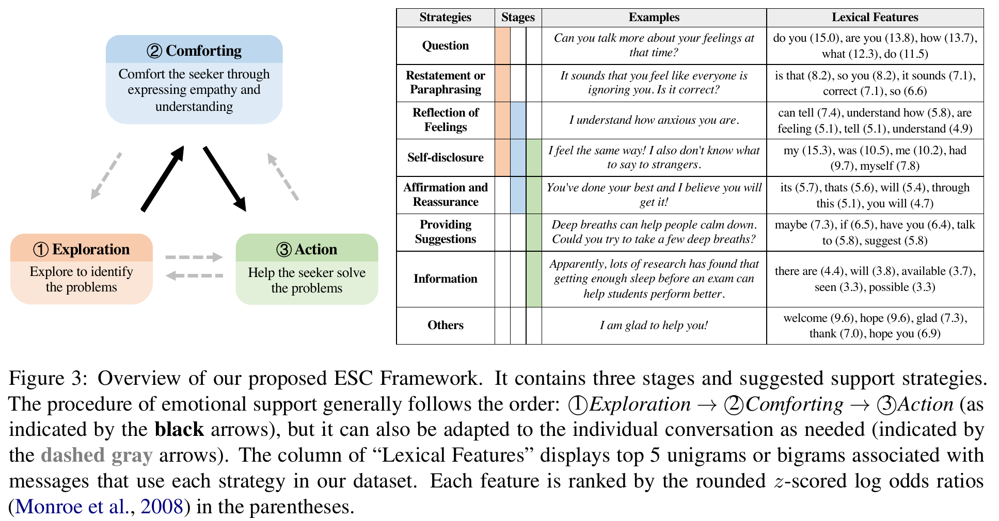
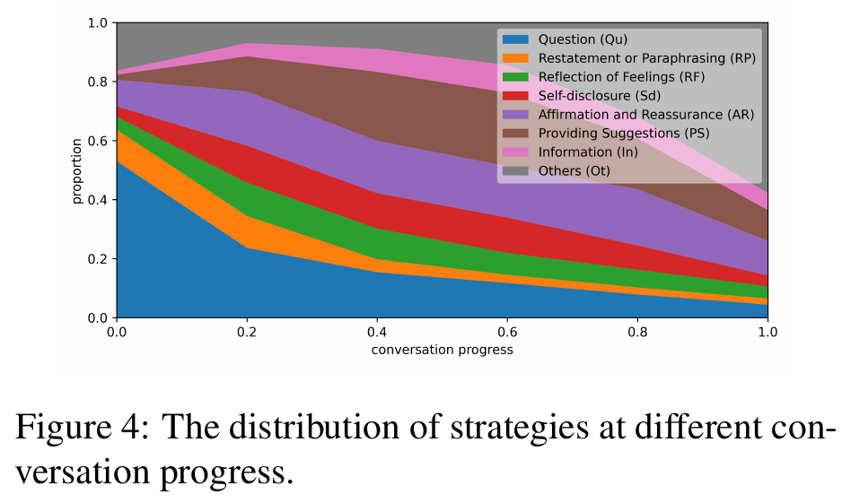
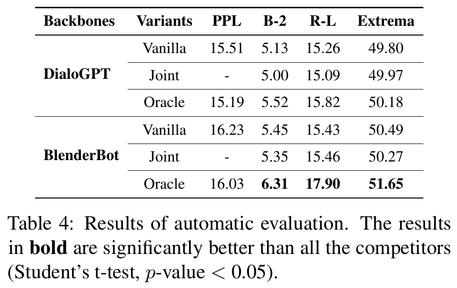
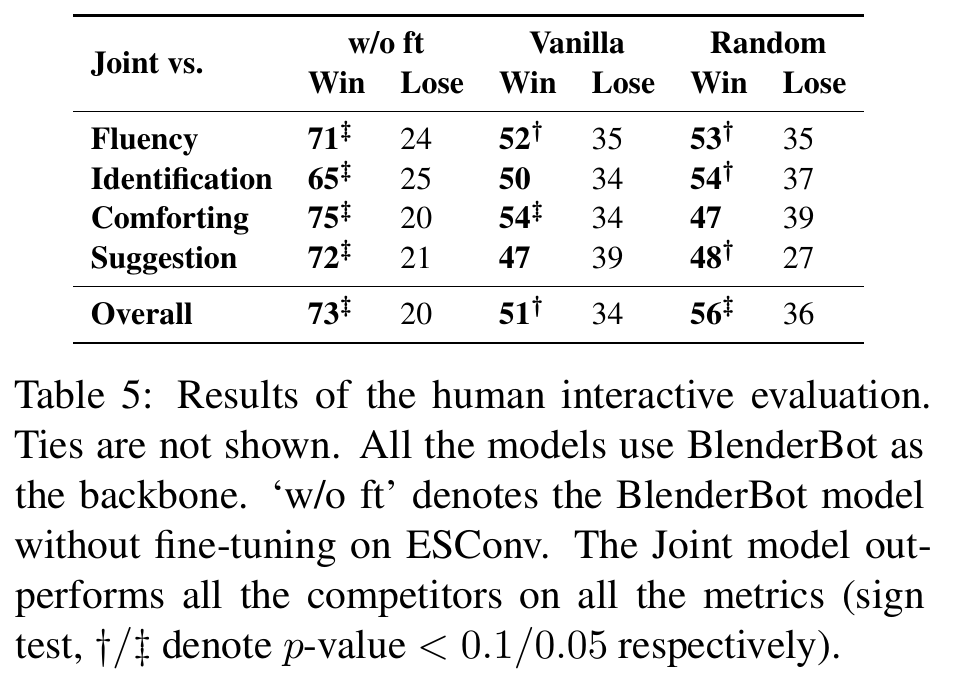

# Towards Emotional Support Dialog Systems：从“表达同理”到“分阶段提供支持”

> 原文：[[Towards Emotional Support Dialog Systems.pdf]]  
> 会议：ACL-IJCNLP 2021  
> 官方页面：https://aclanthology.org/2021.acl-long.269/  
> 数据与代码：https://github.com/thu-coai/Emotional-Support-Conversation

## 关键图表阅读路线

原图来自本目录的 15 页 ACL 会议版 PDF；以下同时标明 PDF 与印刷页码。先理解支持阶段与策略，再区分自动指标和实际交互评价。

| 阅读位置 | 原图表 / PDF 页码 | 重点问题 |
|---|---|---|
| 第 3 节 | Figure 3 / 第 4 页 | 阶段、策略与话语表达有什么关系？ |
| 第 5.4 节 | Figure 4 / 第 7 页 | 不同策略在对话早晚的使用比例怎样变化？ |
| 第 7 节 | Table 4 / 第 8 页 | 正确策略与模型自己预测策略的结果是否一致？ |
| 第 8 节 | Table 5 / 第 8 页 | 人类更喜欢什么，优势是否通过统计检验？ |

## 0. 为什么把它作为第 6 篇

MemoryBank 讨论“长期陪伴系统记住什么”，却没有严格定义“陪伴时应该怎样帮助”。本篇先退一步建立情感支持（Emotional Support Conversation, ESC）的任务、策略和数据：系统不能只复述情绪，而要探索问题、安慰用户、再协助行动。它为后续研究“具有记忆的情感 Agent”提供任务基础和评测语言。

难度：中等。公式不复杂，重点在数据设计、策略监督、人类交互实验及伦理边界。读完要能区分 emotional chatting、empathetic responding、peer emotional support 和 professional counseling。

## 1. 三层摘要

### 一句话

论文提出三阶段、八策略的 ESC 框架，构建 1,053 段、31,410 轮高质量 ESConv 对话，并证明用数据和策略监督微调的 BlenderBot 在人类交互中更受偏好。

### 三句话

1. 只生成带情绪或同理心的单句不能完成多轮情感支持，因为系统还要识别问题、动态选择策略并帮助用户行动。
2. 作者训练众包支持者，收集求助者—支持者长对话，记录问题、情绪强度、逐段反馈及每条支持者消息的策略。
3. 已知正确策略的 Oracle 在自动指标最好；预测策略的 Joint 在自动重合指标略逊 Vanilla，却在人类交互的安慰、问题识别和总体偏好上更好，说明“像参考答案”与“对用户有帮助”并不相同。

### 一段话

ESC 框架改编自 Hill’s Helping Skills Theory，把过程分为 Exploration、Comforting、Action，并定义 Question、Restatement or Paraphrasing、Reflection of Feelings、Self-disclosure、Affirmation and Reassurance、Providing Suggestions、Information、Others 八类策略。ESConv 通过严格培训和质量控制得到平均 29.8 轮的长对话。模型把策略作为特殊 token：先预测策略，再在策略条件下生成回答。实验显示策略标签有用，但策略预测错误会降低 BLEU/ROUGE 等参考重合指标；在人机在线对话中，Joint 模型仍显著优于未微调 BlenderBot，并在部分维度优于无策略 Vanilla 和随机策略模型。

## 2. 问题框架

### Task

给定求助者的多轮历史、当前情绪和问题，系统需要：

1. 选择当前适当的支持策略；
2. 生成符合策略且上下文相关的回复；
3. 跟踪求助者情绪变化；
4. 最终降低痛苦、帮助识别问题或找到可行行动。

### 为什么“我理解你”还不够

用户说：“我失业后很害怕，晚上睡不着。”

- 只有情绪表达：“这真的很难过。”——可能同理，却没有了解具体担忧。
- 过早建议：“马上投 20 份简历。”——可能跳过探索和安慰。
- 更合适的序列：询问最担心什么 → 复述与确认感受 → 肯定已有努力 → 在用户准备好后讨论小步骤。

### Previous Work 与 Gap

Emotional chatting 关注回复表现某种情绪；empathetic dialogue 关注理解和回应经历；既有支持数据常是单轮帖子—回复。ESC 更强调多轮过程、策略时机和结果。本文的主张是：**高质量多轮数据与显式支持策略能使生成模型提供更有效的基础同伴式支持。**

## 3. 三阶段 ESC Framework



*来源：原论文 Figure 3，PDF 第 4 页，印刷第 3472 页。*

**先看左图：** Exploration → Comforting → Action 的黑箭头表示建议顺序，灰色虚线允许根据对话调整。再看右表：策略是阶段内可以采取的沟通动作，例如提问、情绪反映、肯定、建议；阶段与策略不是同一层级。

**具体理解：** 用户说考试失败时，系统可以先提问了解困难，再承接失落，最后共同考虑下一步。右表的 Examples 展示这些动作怎样说出来；Lexical Features 列则是数据中与某策略相关的词语及统计值。

**边界：** 框架不要求每次对话固定走完三步，出现某个高频词也不能充分证明真正使用了对应策略。图提供支持对话的组织原则，不能单独证明某种策略顺序产生了效果。

```text
Exploration → Comforting → Action
     ↑          ↘   ↖        ↓
     └──── 可按用户状态灵活回退 ────┘
```

### 3.1 Exploration：探索

目标是帮助求助者说清事件、感受和核心困难。典型策略：Question、Restatement or Paraphrasing。风险是审问式连续提问或机械复述。

### 3.2 Comforting：安慰

目标是通过理解与陪伴缓解孤立和痛苦。典型策略：Reflection of Feelings、Self-disclosure、Affirmation and Reassurance。自我披露必须服务于用户，而非把话题抢走；保证也不能变成无根据承诺。

### 3.3 Action：行动

目标是帮助用户形成选择和可执行步骤。典型策略：Providing Suggestions、Information。时机关键：过早进入行动会让用户感到不被理解；信息还必须可靠并标注不确定性。

作者将原理论的 insight 阶段替换为 comforting，因为重新解释用户行为、挑战非理性信念需要专业经验，交给普通众包者或系统风险更高。这一删减体现了安全边界意识。

## 4. 八类策略

| 策略 | 功能 | 常见失败 |
|---|---|---|
| Question | 获取经历与需求 | 连环追问、隐私侵犯 |
| Restatement/Paraphrasing | 确认理解 | 机械复读 |
| Reflection of Feelings | 命名和承接情绪 | 擅自诊断情绪 |
| Self-disclosure | 用适度相似经历建立联结 | 抢占话题、虚构经历 |
| Affirmation/Reassurance | 肯定努力、提供希望 | 空洞积极、过度保证 |
| Providing Suggestions | 提供行动选项 | 未经同意直接指导 |
| Information | 提供事实与资源 | 错误信息、越权建议 |
| Others | 收束、感谢等 | 标签过宽，弱化可解释性 |

三阶段不是有限状态机的硬顺序。数据表明开头 Question 更多，后期 Suggestions 增加，安慰类策略贯穿全程；实际对话会来回切换。

## 5. 数据收集与质量控制

### 5.1 角色和流程

求助者在对话前选择 5 类问题、7 类负面情绪，填写 1–5 的情绪强度和情境。支持者先完成 3 阶段 + 8 策略共 11 个教学子任务，通过考试后才能参与；每次发送前选择策略标签，再写回复。

求助者每收到两条支持消息给出 1–5 星帮助度，结束后再次评分情绪强度、同理/理解和相关性。支持者也评价求助者是否充分描述问题。

### 5.2 筛选漏斗

- 5,449 名支持者申请者中 425 人通过培训，7.8%。
- 初收集 2,472 段对话；完成且至少 16 轮的剩 1,342 段，54.3%。
- 自动质量规则后保留 1,053 段，占 1,342 的 78.5%。
- 支持策略标注中 2,545 条（17.1%）被复核，139 条经高分歧检查后修订。

### 5.3 数据规模

| 项目 | 数值 |
|---|---:|
| 对话 | 1,053 |
| 总 utterances | 31,410 |
| 支持者/求助者 utterances | 14,855 / 16,555 |
| 平均每段对话时长 | 22.6 分钟 |
| 平均每段 utterances | 29.8 |
| 参与 workers | 854 |
| 对话前/后平均情绪强度 | 4.04 / 2.14 |

情绪强度下降 1.90 是自报相关证据，但不能视为治疗效应：没有随机对照、等待组或长期随访，筛选规则本身还偏好情绪改善的对话。

### 5.4 策略分布



*来源：原论文 Figure 4，PDF 第 7 页，印刷第 3475 页。*

**读图：** 横轴是归一化对话进度，不是固定轮数；纵轴是策略比例。各颜色带的厚度代表该阶段使用某策略的占比，不能把色带的上边界直接当作该策略的数值。

**具体观察：** Question 在早期占比较大，随后减少；Providing Suggestions 后期占比增加，安慰类策略贯穿过程。这与“先了解，再支持和行动”的建议相符，也说明支持策略需要考虑时机。

**边界：** 它统计的是数据中的使用规律，没有随机分配策略顺序，所以不能据此断定照搬同一顺序就一定更有效。不同长度对话被归一化后，实际轮数差异也被隐藏了。

Question 3,109（20.9%）、Affirmation/Reassurance 2,388（16.1%）、Providing Suggestions 2,323（15.6%）、Self-disclosure 1,396（9.4%）、Reflection of Feelings 1,156（7.8%）、Information 904（6.1%）、Restatement 883（5.9%）、Others 2,696（18.1%）。类别不平衡会影响策略预测；“Others”过大也说明策略体系并非穷尽。

## 6. 模型：策略 token 如何进入生成

设对话历史为 $x$，目标回复为 $y=(y_1,\ldots,y_T)$。

### 6.1 Vanilla

$$
P(y\mid x)=\prod_{i=1}^{T}P(y_i\mid x,y_{<i})
$$

直接在 ESConv 上微调，不使用策略标签。

### 6.2 策略条件生成

把策略 $s_t$ 表成特殊 token $[s_t]$，拼到回复前：

$$
\tilde y=[s_t]\oplus y
$$

Joint 模型的联合概率：

$$
P(\tilde y\mid x)=P([s_t]\mid x)\prod_{i=1}^{T}P(y_i\mid x,[s_t],y_{<i})
$$

- $x$：扁平化对话历史；
- $s_t$：当前策略类别；
- $\oplus$：序列拼接；
- $T$：回复 token 数；
- $y_{<i}$：此前已生成 token。

直觉：先决定“现在要做什么”，再决定“具体怎么说”。训练时最大化金标策略和回复的似然；推理时 Joint 自己预测策略。Oracle 直接给金标策略，是上限而非可部署系统；Random 按数据总体分布随机采样策略，用于检验时机是否重要。

### 6.3 与 Agent 规划的关系

这里的策略 token 是 turn-level policy，不是跨数小时的计划；它比 ReAct action 更抽象，又比 Generative Agents 的日计划更短。可以把它看成一个轻量层级策略：

```text
对话阶段/用户状态 → support strategy → natural-language response
```

## 7. 自动评估



*来源：原论文 Table 4，PDF 第 8 页，印刷第 3476 页。*

**读表：** 固定同一底座再比 Vanilla、Joint、Oracle。Vanilla 不使用策略标签，Joint 自己预测策略，Oracle 直接获得人工参考策略；PPL 越低越好，其余指标越高越好。横线“—”表示未报告，不能按 0 计算。

**具体比较：** BlenderBot 的 Oracle ROUGE-L 为 17.90，高于 Vanilla 的 15.43；但 Joint 为 15.46，并未达到 Oracle 的收益。BLEU-2 上 Joint 5.35 还略低于 Vanilla 5.45，说明给定正确策略的优势不能直接等同于自动选策略的优势。

**边界：** Oracle 使用测试时通常不可得的金标条件；这些指标也主要反映与参考答案的相似性。是否真正帮助用户，需要继续看人类交互评价。

底座为 DialoGPT-small 与 BlenderBot-small-90M。指标：PPL 越低越好；BLEU-2、ROUGE-L、Embedding Extrema 越高越好。这些指标主要测参考相似或语义近似，不直接测用户是否被帮助。

| Backbone | Variant | PPL↓ | BLEU-2↑ | ROUGE-L↑ | Extrema↑ |
|---|---|---:|---:|---:|---:|
| DialoGPT | Vanilla | 15.51 | 5.13 | 15.26 | 49.80 |
| DialoGPT | Joint | — | 5.00 | 15.09 | 49.97 |
| DialoGPT | Oracle | **15.19** | **5.52** | **15.82** | **50.18** |
| BlenderBot | Vanilla | 16.23 | 5.45 | 15.43 | 50.49 |
| BlenderBot | Joint | — | 5.35 | 15.46 | 50.27 |
| BlenderBot | Oracle | **16.03** | **6.31** | **17.90** | **51.65** |

Oracle 显著优于竞争者，说明正确策略条件很有用；Joint 多数自动指标略低于 Vanilla，因为一旦预测策略与参考不同，即使回复合理，n-gram 重合也下降。这是评价失配的典型例子。

## 8. 人类交互评估



*来源：原论文 Table 5，PDF 第 8 页，印刷第 3476 页；保留平局说明与显著性标记。*

**读表：** 每个对照下都有 Win / Lose 两列，表示参与者更偏好 Joint 还是对照，平局没有列出。`w/o ft` 是未在 ESConv 微调的模型，Vanilla 使用该数据但不显式用策略，Random 则随机采样策略。三者回答不同的实验问题。

**具体比较：** Overall 中 Joint 对未微调模型为 73 胜 / 20 负，对 Vanilla 为 51 胜 / 34 负，后者还剩 15 次平局。这些是每对 100 次比较中的数量，不能解释为准确率提高 51 个百分点。

**边界：** `†` 对应 p<0.1，`‡` 对应 p<0.05，部分优势仅为数值更高或较弱证据。例如 Joint 对 Random 的 Comforting 为 47 / 39 且无标记，不能声称所有维度都在 p<0.05 下显著更好；偏好结果也不是长期效果指标。

每名参与者与两个随机排序模型对话；每对模型 100 段比较。表中不含 ties：

| Joint 对比 | 流畅 Win/Lose | 识别问题 | 安慰 | 建议 | 总体 |
|---|---:|---:|---:|---:|---:|
| 未微调 BlenderBot | 71/24 | 65/25 | 75/20 | 72/21 | 73/20 |
| Vanilla | 52/35 | 50/34 | 54/34 | 47/39 | 51/34 |
| Random strategy | 53/35 | 54/37 | 47/39 | 48/27 | 56/36 |

Joint 相对未微调模型全维度显著更好；相对 Vanilla，在安慰和总体偏好占优；相对 Random，在识别问题和建议上占优，支持“正确时机”有价值。安慰上 Joint 47/39 未显著赢 Random，提醒我们不是每个维度都稳定改善。

## 9. 证据链应怎样表述

证据支持：

- 培训和筛选能收集长、多策略、求助者自报改善的对话；
- 给定金标策略能提高参考式自动指标；
- ESConv 微调与策略预测在特定人机对话比较中提高偏好。

证据不支持：

- 系统能替代专业心理咨询；
- 情绪下降由支持本身因果造成；
- 策略标签就是模型真实的内部决策理由；
- 离线 BLEU 提升等价于心理获益；
- 对危机、自伤、创伤或临床障碍同样安全有效。

## 10. 局限与安全

### 作者明确讨论

不同支持层级中，专业支持对系统可能不恰当且危险；论文只迈向基础、适度的支持，仍需大量工作确定系统应提供到什么程度。

### 设计中可进一步看到

- 数据只保留高质量对话，部署时面对低配合、冲突和危机会有分布偏移。
- 策略由支持者自标，可能把意图与表面措辞混合；模型学到词汇捷径。
- 支持者培训后的对话不是自然真实关系，且角色知道研究目的。
- 情绪强度是即时自报，没有数日后持续效果。
- Self-disclosure 对 AI 尤其棘手：模型说“我也经历过”可能构成拟人欺骗。
- 建议和信息存在医疗、法律、财务越权风险。
- 数据中的私密经历需要严格匿名、同意和删除治理。

## 11. 与 MemoryBank 和实验室方向的结合

MemoryBank 回答“找回哪段过去”，ESConv 回答“当前用哪类支持行为”。组合后形成：

```text
长期记忆检索
   ↓
用户状态与当前需要估计
   ↓
阶段/策略选择
   ↓
回复生成
   ↓
用户反馈 → 更新状态与记忆（需用户控制）
```

这直接对应实验室的多轮交互、个性化、情感计算、动态 Agent 演化和人机协作。但“降低自报情绪强度”不等于主体性；“选择同理策略”也不等于 Agent 真的体验同理心。

## 12. 最小复现蓝图

### 最小系统

1. 用公开 ESConv 划分训练/验证/测试。
2. 训练 `history → strategy` 分类器。
3. 训练 `history + strategy → response` 生成器。
4. 比较 Vanilla、Gold/Oracle、Predicted/Joint、Random。
5. 记录策略混淆矩阵和阶段位置，而不只总准确率。

### 应控制

固定底座、参数量、训练 token、解码温度和历史长度；按对话而非 utterance 划分，避免同一对话泄漏；人评盲化系统身份与顺序。

### 更合理的指标组合

- 策略 macro-F1、阶段转换合理性；
- 相关、具体、非评判、用户自主性、建议可行性；
- 情绪变化前后及延迟随访；
- 危机识别、适当转介、虚假自我披露、过度保证；
- 依赖、操控、隐私重提和个性化错误。

## 13. 可做的三个小研究问题

1. 加入长期记忆后，策略选择是否更合适，还是旧画像使系统误读当前情绪？
2. 用“用户是否准备好听建议”的显式状态控制 Action 阶段，能否减少过早建议？
3. 将自我披露改成透明的非人格化表达，是否在不降低联结感的前提下减少拟人欺骗？

## 14. 三遍阅读计划

1. **Why（30 分钟）**：读引言和第 3 节，只回答“情感支持为何不等于同理回复”。
2. **What（60–90 分钟）**：精读图 3、表 1–3，画数据收集漏斗与八策略。
3. **How（90–150 分钟）**：推导两个概率分解，核对表 4–5，审查自动指标与人评结论是否一致。

## 15. 速查表

| 概念 | 含义 | 关键提醒 |
|---|---|---|
| ESC | 旨在降低痛苦并帮助应对的多轮支持 | 不等于闲聊或治疗 |
| Exploration | 了解问题 | 不要审问 |
| Comforting | 承接情绪 | 不要空洞保证 |
| Action | 形成选择/步骤 | 时机与自主性重要 |
| Oracle | 输入金标策略 | 不可部署的上界 |
| Joint | 先预测策略再生成 | 策略错误会传播 |
| Random | 按总体分布随机选策略 | 控制“有标签但无时机” |

## 16. 常见误解

- “同理心模型就是情感支持系统”——同理只是其中一部分。
- “三阶段必须线性执行”——框架允许按状态回退和切换。
- “自动指标下降说明 Joint 更差”——人机评估给出相反的部分证据。
- “情绪从 4.04 降到 2.14 证明治疗有效”——筛选与无对照使因果结论不成立。
- “模型的自我披露是真实经历”——语言模型没有可验证的人类生活经历。

## 17. 自测题

1. ESC 与 emotional chatting、empathetic response 的差别是什么？
2. 三阶段为何把 insight 改为 comforting？
3. 八类策略分别是什么？
4. 为什么阶段顺序不能写死？
5. ESConv 的规模和平均长度是多少？
6. 质量筛选如何影响数据分布？
7. Joint 的概率分解表达了哪两个子任务？
8. Oracle 为什么不是可部署模型？
9. Random baseline 控制了什么？
10. 为什么 Joint 自动指标略低、人评却更好？
11. 表 5 哪些比较显著，哪些并不稳？
12. 即时情绪自报的盲点是什么？
13. AI 自我披露为什么有伦理问题？
14. 若结合 MemoryBank，应新增哪两个安全检查？
15. 本文能否支持“AI 具有同理心”？为什么？

## 18. 反思模板

```text
情感支持区别于普通共情回复的核心：

我最容易误用的一种策略及原因：

表 4 与表 5 的冲突告诉我：

数据筛选带来的最大偏差：

若加入长期记忆，收益与新风险分别是：

我会新增的一个安全场景和一个指标：
```

## 19. 长期记忆锚点

1. ESC 三阶段：Exploration → Comforting → Action，但可灵活切换。
2. 八策略作为 turn-level action，策略时机很重要。
3. ESConv：1,053 对话、31,410 utterances、平均 29.8 轮。
4. Joint = 预测策略 + 条件生成；Oracle = 金标策略上限。
5. 自动文本重合与真实支持偏好可能背离。
6. 基础同伴支持不等于专业咨询，同理措辞不等于真实同理心。
7. 下一阶段要学习如何在多 Agent 社会互动中系统评估目标、关系、秘密和规范。
